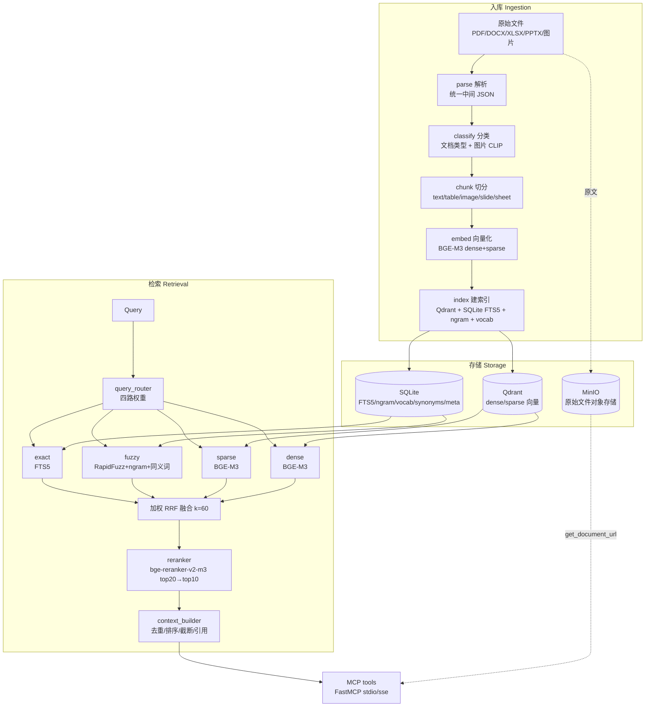

# rag-zh · 高级中文 RAG 系统

面向中文办公文档（PDF / Word / Excel / PPT / 图片）的**多模态检索增强生成**引擎：
精确 + 模糊 + 稀疏向量 + 稠密向量四路召回，加权 RRF 融合 + 交叉编码器重排，对外以 **MCP** 标准协议暴露工具，可直接接入 Claude Desktop 等 LLM 客户端。

---

## 1. 架构总览



**四路召回**：`exact(FTS5) + fuzzy(RapidFuzz + n-gram + 同义词) + sparse(BGE-M3) + dense(BGE-M3)`
**融合链路**：`Query → 路由 → 四路并行召回 → 加权 RRF(k=60) → Rerank(top20→top10) → Context 组装 → LLM`

---

## 2. 快速开始（3 步）

```bash
# ① 克隆
git clone https://github.com/octpus1230216-alt/rag_gov.git && cd rag_gov
python -m venv .venv && source .venv/bin/activate   # Windows: .venv\Scripts\activate
pip install -U pip

# ② 一键初始化（装依赖 + 下模型 + 起 Qdrant/MinIO + 建索引 + 建词表）
cp config/settings.example.yaml config/settings.yaml
bash scripts/bootstrap.sh

# ③ 启动 MCP 服务
python -m mcp_server.server          # stdio（本地客户端）
python -m mcp_server.server --sse    # SSE（Web/远程，默认 0.0.0.0:8765）
```

接入 Claude Desktop，在 `claude_desktop_config.json` 里加：

```json
{
  "mcpServers": {
    "rag-zh": { "command": "python", "args": ["-m", "mcp_server.server"] }
  }
}
```

---

## 3. 目录结构

```
rag-zh/
├── config/            配置：settings.yaml、autodetect.py、synonyms.yaml、stopwords_zh.txt
├── ingestion/         入库：pipeline.py + parsers/ + classifiers/ + chunkers/
├── embedding/         向量化：text_embedder.py(BGE-M3) + image_embedder.py(Chinese-CLIP)
├── index/             索引层：vector_store(Qdrant) + keyword_store(FTS5) + ngram + vocab + metadata
├── retrieval/         检索层：query_router + fuzzy + hybrid_search + reranker + context_builder
├── mcp_server/        MCP 接口：server.py + tools.py（6 个工具）
├── schemas/           JSON Schema：chunk + mcp_tools
├── scripts/           运维脚本：bootstrap.sh / init_qdrant / build_index / rebuild_vocab
├── eval/              评测：qa_set.jsonl + run_eval.py
├── samples/           示例文档（不含真实数据）
├── storage/           运行时产物（SQLite/索引，已 gitignore）
└── pyproject.toml     依赖与入口锁定
```

---

## 4. 配置说明

配置集中在 `config/settings.yaml`（从 `settings.example.yaml` 拷贝，已 gitignore）。

### 4.1 profile（硬件档位）
| 档位 | 适用 | 关键差异 |
|------|------|----------|
| `auto` | 默认 | 由 `autodetect.py` 探测内存/GPU/磁盘，自动落到下面三档 |
| `lite` | 无独显 + 内存 <16GB | 降级 `bge-small-zh-v1.5`（只 dense）、全 on_disk、纯 CPU |
| `standard` | 16GB+SSD（可选 GPU） | `BGE-M3` dense+sparse、int8 量化、reranker 开 |
| `performance` | GPU + ≥32GB | HNSW 常驻内存、大 batch、多 worker |

### 4.2 synonyms（同义词）
`config/synonyms.yaml` 格式 `{主词: [同义词...]}`，加载后做**双向展开**，供 fuzzy 路扩展（深度=1）。

### 4.3 stopwords（停用词）
`config/stopwords_zh.txt` 每行一词，UTF-8 无注释。只用于**关键词提取 / n-gram 模糊索引降噪**；
exact(FTS5) 路不做整句停用词剔除，避免丢掉「2024年」「华东」这类限定词。

---

## 5. MCP 工具列表

| 工具 | 作用 | 关键参数 |
|------|------|----------|
| `search` | 混合检索，返回带引用 top-k | `query, top_k, mode(semantic/keyword/fuzzy/hybrid), filters` |
| `ingest` | 导入文件/目录，跑完整流水线 | `path` |
| `get_chunk` | 按 chunk_id 取完整片段 | `chunk_id` |
| `list_documents` | 列出已入库文档（可过滤） | `filters{doc_type,language,source_format}` |
| `get_document_url` | 取原文 MinIO 预签名 URL | `doc_id` |
| `classify_image` | 图片 zero-shot 场景分类 | `image_path` |

调用示例（`search`）：

```json
{
  "name": "search",
  "arguments": {
    "query": "第三条 违约责任",
    "top_k": 5,
    "mode": "hybrid",
    "filters": { "doc_type": "contract" }
  }
}
```

返回：`[{chunk_id, content, score, metadata, section_path, doc_id, bbox}]`

---

## 6. 部署说明

### 本地（隐私优先）
全链路单机：`docker compose up -d`（Qdrant + MinIO）+ MCP stdio。模型走 CPU 时选 `lite`/`standard`。

### 云 GPU 入库（大库吞吐）
解析/向量化是 IO+算力密集段，可把 `ingestion` 放 GPU 机器批量跑：
- profile 设 `performance`（`device=cuda`、fp16、大 batch）；
- 云端跑 `python scripts/build_index.py --input /data/docs --to-stage index`；
- 索引写入的 Qdrant/MinIO 用内网地址（环境变量 `QDRANT_HOST`/`MINIO_ENDPOINT` 注入）；
- 检索服务（MCP）可在本地起，连同一套远端 Qdrant。

---

## 7. GitHub 托管策略

**进仓库**：所有源码、`config/*.example.yaml`、`synonyms.yaml`、`stopwords_zh.txt`、`schemas/`、`scripts/`、`eval/qa_set.jsonl`、占位 `samples/`。

**不进仓库**（见 `.gitignore`）：
- `config/settings.yaml`（可能含端点/密钥覆盖）
- `storage/`（SQLite、索引产物）
- `data/`、真实文档、`*.pdf/*.docx` 等业务文件
- `.venv/`、`__pycache__/`、`logs/`、HF 模型缓存
- 任何真实密钥 —— MinIO/Qdrant 凭证一律走环境变量注入

---

## 8. 性能指标（参考）

| 场景 | 指标 | 说明 |
|------|------|------|
| 检索延迟 | dense+sparse 召回 | standard 档 P50 < 80ms |
| 重排 | top20→top10 | CPU(lite) < 300ms；GPU < 50ms |
| 入库 | 单文档(10页PDF) | 解析占大头，OCR 视页数 |
| 召回质量 | Recall@10 | 见 `eval/run_eval.py` 输出 |

> 指标随硬件与文档复杂度波动，请以 `python eval/run_eval.py` 实测为准。

---

## 9. 常见问题

**Q：首次 `search` 卡很久？**
A：模型懒加载。`bootstrap.sh` 已预下载；服务启动会预热单例。仍慢检查 profile 是否误落 `lite`（CPU）。

**Q：lite 档为什么没有 sparse 结果？**
A：`bge-small-zh-v1.5` 不产 BGE-M3 的 `lexical_weights`，sparse 路自动跳过，权重在其余三路归一化，不补零向量。

**Q：换 doc_id 策略后检索不到旧文档？**
A：同一套库必须固定一种 `--id-strategy`。换策略需清库重建（`storage/` 清空后重跑 `build_index.py`）。

**Q：fuzzy 结果噪声大？**
A：fuzzy 只作 RRF 一路候选，**绝不绕过 rerank 直接给 LLM**（`fuzzy_output_allowed_bypass_rerank: false`）。调 `fuzzy_score_cutoff` 控阈值。

**Q：中文 FTS5 命中差？**
A：本系统在写入前用 jieba **预分词**再进 FTS5（`unicode61`），不用默认 tokenizer 直吃中文——这是硬红线。

---

## 10. 许可

本仓库为个人学习与作品展示用途，未附加开源许可证。代码仅供阅读参考；
如需使用、修改或分发，请先联系仓库所有者取得授权。
