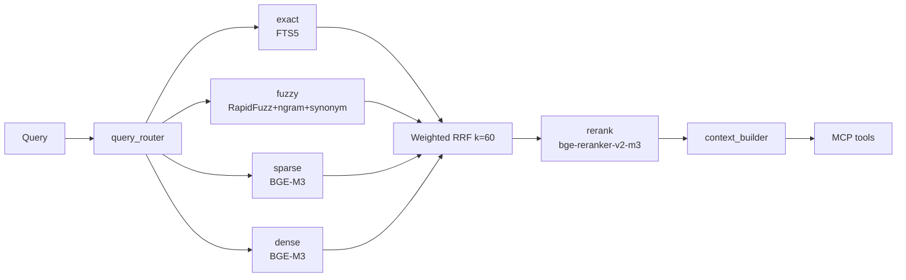

# rag-zh · Advanced Chinese RAG System

A retrieval-augmented-generation engine for Chinese office documents
(PDF / Word / Excel / PPT / images): four-way recall (semantic + exact + fuzzy),
weighted RRF fusion + cross-encoder reranking, exposed as **MCP** tools that plug
directly into LLM clients like Claude Desktop.

> Full documentation (architecture, tuning, deployment) is in [README.md](README.md).
> This file is a condensed English overview.

---

## Architecture



**Four-way recall**: `exact(FTS5) + fuzzy(RapidFuzz + n-gram + synonyms) + sparse(BGE-M3) + dense(BGE-M3)`
**Pipeline**: `Query → route → parallel recall → weighted RRF → rerank(top20→top10) → context → LLM`

---

## Quick Start (3 steps)

```bash
# 1. Clone + venv
git clone <your-repo>/rag-zh.git && cd rag-zh
python -m venv .venv && source .venv/bin/activate
pip install -U pip

# 2. One-shot bootstrap (deps + models + Qdrant/MinIO + index + vocab)
cp config/settings.example.yaml config/settings.yaml
bash scripts/bootstrap.sh

# 3. Run the MCP server
python -m mcp_server.server          # stdio (local clients)
python -m mcp_server.server --sse    # SSE (web/remote, 0.0.0.0:8765)
```

Claude Desktop config:

```json
{ "mcpServers": { "rag-zh": { "command": "python", "args": ["-m", "mcp_server.server"] } } }
```

---

## Layout

| Dir | Responsibility |
|-----|----------------|
| `config/` | settings, hardware profile autodetect, synonyms, stopwords |
| `ingestion/` | parse → classify → chunk pipeline |
| `embedding/` | BGE-M3 text embedder, Chinese-CLIP image embedder |
| `index/` | Qdrant vector store, SQLite FTS5, n-gram, vocab, metadata |
| `retrieval/` | query router, fuzzy, hybrid search, reranker, context builder |
| `mcp_server/` | FastMCP server + 6 tools |
| `schemas/` | chunk + MCP tool JSON Schemas |
| `scripts/` | bootstrap, init_qdrant, build_index, rebuild_vocab |
| `eval/` | QA set + retrieval metrics (Recall@k, MRR) |

---

## Profiles

- `auto` — resolved by `autodetect.py` into one of the three below.
- `lite` — CPU only, downgrade to `bge-small-zh-v1.5` (dense only), everything on disk.
- `standard` — BGE-M3 dense+sparse, int8 quantization, reranker enabled.
- `performance` — GPU, HNSW in RAM, large batch, many workers.

---

## MCP Tools

| Tool | Purpose |
|------|---------|
| `search` | hybrid retrieval with citations |
| `ingest` | import file/dir through full pipeline |
| `get_chunk` | fetch full chunk by id |
| `list_documents` | list indexed documents (filterable) |
| `get_document_url` | presigned MinIO URL for the original file |
| `classify_image` | zero-shot image classification (Chinese-CLIP) |

---

## Repo policy

**Tracked**: source, `*.example.yaml`, lexicons, schemas, scripts, eval QA set, placeholder samples.
**Never committed** (see `.gitignore`): `config/settings.yaml`, `storage/`, real documents, `.venv/`,
`logs/`, model caches, and **any credentials** — MinIO/Qdrant secrets are injected via environment variables.

---

## Notes

- Fuzzy results never bypass the reranker (`fuzzy_output_allowed_bypass_rerank: false`).
- Chinese FTS5 uses jieba **pre-tokenization** before indexing — never the raw default tokenizer.
- Pick one `doc_id` strategy per library; changing it requires a clean rebuild.

Run `python eval/run_eval.py` for measured Recall@5 / Recall@10 / MRR by query type.
